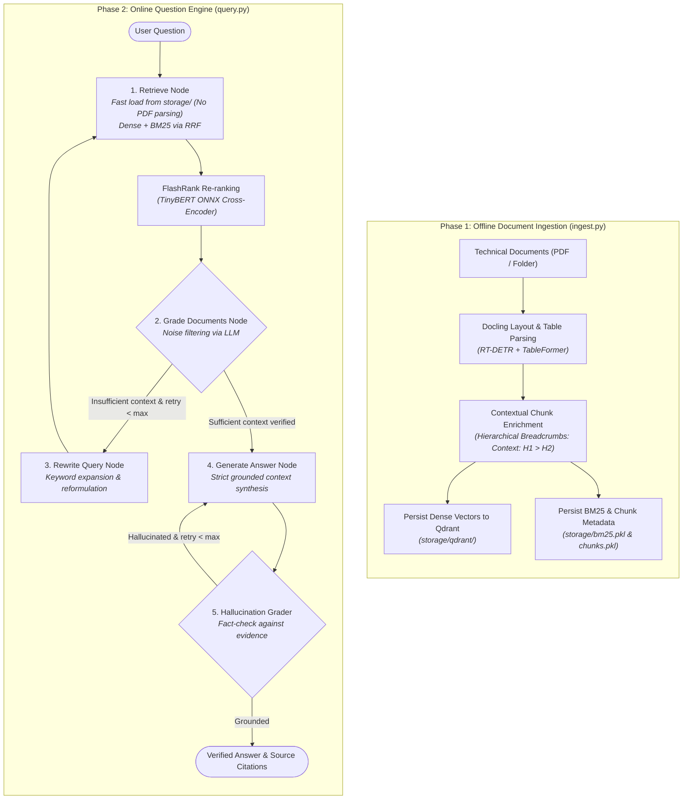

# Corrective RAG (CRAG) Engine with LangGraph & Docling

An autonomous, self-reflective **Corrective Retrieval-Augmented Generation (CRAG)** framework engineered for technical, table-dense, and structure-critical documents.

The system is decoupled into two independent stages:
1. **Offline Document Ingestion**: Heavy document layout parsing (Docling), hierarchical breadcrumb enrichment, dense vector indexing (Qdrant on disk), and sparse lexical index persistence (BM25).
2. **Online Question Engine**: Low-latency query serving, hybrid dense-sparse search fused via Reciprocal Rank Fusion (RRF), Cross-Encoder Re-ranking (FlashRank), and an autonomous LangGraph cyclic state machine with query reformulation and hallucination guardrails.

---

## 1. System Architecture



---

## 2. Quickstart

### Environment Setup
```bash
pip install -r requirements.txt
# Create a .env file and set your GOOGLE_API_KEY
echo "GOOGLE_API_KEY=your_gemini_api_key_here" > .env
```

### Phase 1: Offline Ingestion
Run once per document update. Vector and keyword indices are persisted to `storage/`:

```bash
# Ingest a single PDF file
python ingest.py --pdf data/docling_technical_report.pdf

# Or ingest all PDF files in a directory
python ingest.py --dir data/

# Optional: Append new documents without overwriting existing index
python ingest.py --pdf data/new_document.pdf --append
```

### Phase 2: Online Question Answering
Starts immediately without re-parsing documents:

```bash
# Interactive terminal session:
python query.py

# Single-shot CLI question:
python query.py --question "What dataset does Docling evaluate on for layout analysis?"
```

### Unified CLI (`main.py`)
```bash
# Ingestion:
python main.py ingest --pdf data/docling_technical_report.pdf

# Query:
python main.py query
```

---

## 3. Running with Docker & Docker Compose

Preconfigured with [`Dockerfile`](Dockerfile), [`.dockerignore`](.dockerignore), and [`docker-compose.yml`](docker-compose.yml). Host directories (`./data` and `./storage`) are mounted as volumes to ensure index persistence.

### Option A: Docker Compose (Recommended)

1. **Configure Environment:**
   ```bash
   # Ensure .env exists with your GOOGLE_API_KEY
   echo "GOOGLE_API_KEY=your_gemini_api_key_here" > .env
   ```

2. **Run Offline Ingestion:**
   ```bash
   # Ingest directory data/
   docker compose run --rm ingest

   # Or ingest a specific file:
   docker compose run --rm ingest ingest.py --pdf data/docling_technical_report.pdf
   ```

3. **Run Online Question Engine:**
   ```bash
   # Interactive Q&A:
   docker compose run --rm query

   # Single query:
   docker compose run --rm query query.py --question "What is TableBench?"
   ```

### Option B: Docker CLI

1. **Build Image:**
   ```bash
   docker build -t crag-engine:latest .
   ```

2. **Run Ingest:**
   ```bash
   docker run --rm \
     -v "$(pwd)/data:/app/data" \
     -v "$(pwd)/storage:/app/storage" \
     --env-file .env \
     crag-engine:latest ingest.py --pdf data/docling_technical_report.pdf
   ```

3. **Run Query (Interactive):**
   ```bash
   docker run --rm -it \
     -v "$(pwd)/storage:/app/storage" \
     --env-file .env \
     crag-engine:latest query.py
   ```

---

## 4. Key Architectural Highlights

### Structure-Preserving Document Parsing (Docling)
* **Table Reconstruction:** Replaces basic text extractors with Docling vision models (RT-DETR + TableFormer) to preserve complex borderless tables as formatted Markdown tables.
* **Contextual Breadcrumb Enrichment:** Automatically prepends hierarchical section paths (`Context: H1 > H2 > Table`) to each chunk, preventing loss of context when table rows or paragraphs are retrieved in isolation.

### Persistent Hybrid Retrieval (Qdrant + BM25)
* **Decoupled Lifecycle:** Qdrant vectors and BM25 lexical models persist on disk in `storage/`, allowing the query interface to start instantly without importing heavy layout or parsing dependencies.
* **Reciprocal Rank Fusion (RRF):** Fuses dense semantic scores and sparse keyword ranks using:
  $$RRF(d) = \sum \frac{1}{60 + \text{rank}(d)}$$

### Ultra-Low Latency Cross-Encoder Re-Ranking (FlashRank)
* Filters candidate passages down to the top-K highest-signal contexts using `ms-marco-TinyBERT-L-2-v2` running on an optimized ONNX runtime.

### Active Self-Reflective Document Grading & Cyclic State Machine
* **Noise Filtering:** An LLM grading node inspects retrieved chunks against the query, filtering out irrelevant context before generation.
* **Autonomous Query Rewriter:** When context is insufficient, LangGraph dynamically routes execution to rewrite and expand the search query.
* **Hallucination Guardrail:** Evaluates synthesized answers against evidence chunks, triggering a regeneration loop if ungrounded assertions are detected.

---

## 5. Technical Resume Summary

```text
• Engineered a production-grade Corrective RAG (CRAG) system in Python using LangGraph, replacing linear Naive RAG pipelines with an autonomous, self-correcting control loop.
• Decoupled document ingestion from online inference: persisted layout-aware vision parsing (Docling) into on-disk Qdrant and BM25 storage for sub-second query initialization.
• Developed a low-latency Hybrid Retrieval layer fusing Qdrant dense vectors with BM25 via Reciprocal Rank Fusion (RRF), followed by an ONNX-accelerated FlashRank cross-encoder reranker.
• Implemented self-reflective state nodes for document relevance grading, automatic query rewriting, and closed-loop hallucination fact-checking.
```
